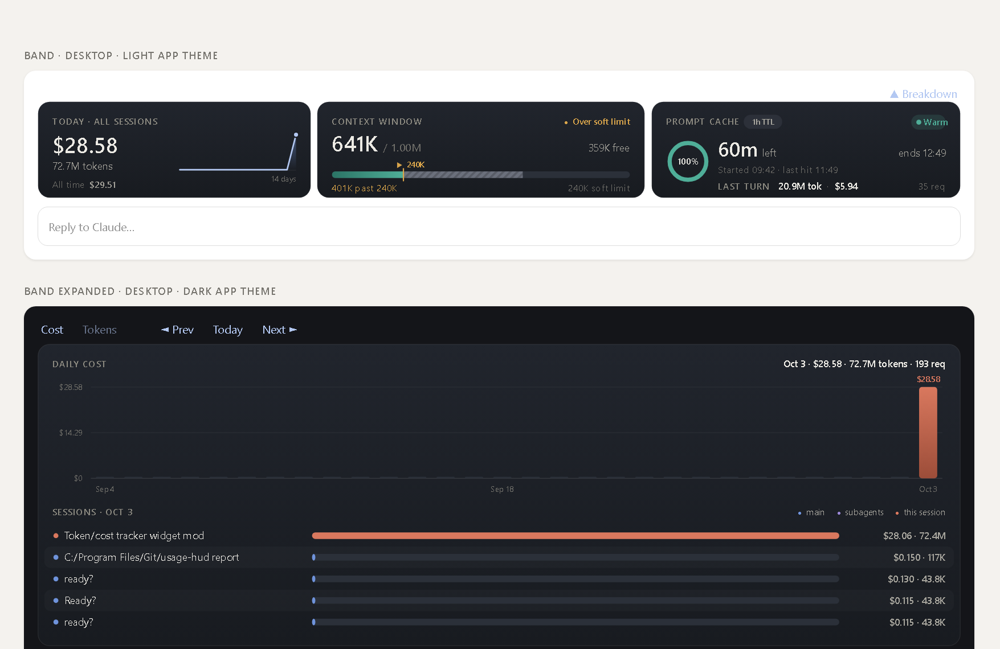

# usage-hud: a Claude Code mod

A [Claude Code mod](https://code.claude.com/docs/en/plugins/mods/overview) that puts a three-card HUD in the band directly above the prompt, in the **Claude Code CLI** and in the **Code tab of Claude Desktop**.



| Card | What it shows |
| :- | :- |
| **Today · all sessions** | Tokens and API-equivalent cost **today across every local session**, a 14-day trend, and the all-time total. **▲ Breakdown** opens, on demand, a 30-day chart (cost or tokens) with the **per-session split** for the selected day. **◄ ►** moves between days, subagent spend shows in violet, and this session in coral. |
| **Context window** | This conversation's context against the model's window. The meter is **teal up to a 240K soft limit**, marked by an amber **▼** above the bar; anything past it is **hatched gray** as "not optimal". Shows tokens free and the distance to or past the soft limit. |
| **Prompt cache** | The TTL the API actually wrote (1h or 5m), when the current **warm streak started**, the last cache hit, a live **m:ss countdown** to expiry from the last request (teal → amber → coral) and the **expiry time in your local zone** (ET, CT, UTC…). On Desktop, where every band redraw flickers its buttons, the band changes once a minute and the exact m:ss ticks in the status line, and the **last turn's tokens and cost**, subagents included. |

Desktop draws each card as one rounded SVG image (gradient columns, an area sparkline, a ring gauge, a gradient context meter) with its own typography, and redraws only when a figure changes, so nothing flickers. The terminal draws the same cards with solid color-filled cells and half-cell edges on a matte card surface, in 24-bit color. The band shows the three cards by default. The breakdown opens on demand: in its own pane on Desktop, and above the cards in a terminal (or as a pane when the terminal is too short).

## Install

**Full instructions for Windows and macOS, CLI and Desktop: [INSTALL.md](INSTALL.md).**

Quick version, for Claude Code 2.1.287+ with Node.js 18+ and git:

```
/plugin marketplace add chandan84/cache-time-pending-usage-limit-mod
/plugin install usage-hud@usage-hud-mods
/reload-plugins
```

Check a machine first with `scripts/check-prereqs.ps1` (Windows) or `scripts/check-prereqs.sh` (macOS).

## Commands

| Command | What it does |
| :- | :- |
| `/usage-hud` | Open or close the daily/per-session breakdown (a pane on Desktop, above the cards in a terminal) |
| `/usage-hud pane` | Open the breakdown in a pane |
| `/usage-hud report` | Print a text summary (works where nothing is drawn, such as `claude -p`) |
| `/usage-hud refresh` | Re-read history now |
| `/usage-hud guard [on\|off]` | Turn the cache guard on or off (see below); no argument toggles it |
| `/usage-hud limit 300k` | Move the context soft limit (saved; overrides the plugin option). `/usage-hud limit reset` goes back to the option |

**Cache guard.** When the prompt cache has expired, the next prompt you send re-reads the whole context at the uncached rate. With the guard on, Claude Code first asks whether to continue in the same session, with the token count and the cost of re-caching against the warm rate: **Continue**, **Continue and turn guard off**, or **Cancel** (the prompt isn't sent; its text comes back in the message so you can resend it). Slash commands, scheduled prompts and messages typed mid-turn are never asked about. The **GUARD ON / OFF** button on the cache card (Desktop: **Cache guard ● ON** above the cards) is the switch and the indicator; it's saved across sessions.

Options (`/plugin configure usage-hud@usage-hud-mods`): `context_soft_limit` (default `240000`), `history_days` (default `30`), `live_seconds` (default `false`; Desktop only: `true` redraws the band every second, which can flicker its buttons) and `cache_guard` (default `true`; the starting state before you use the switch).

## How it works

- **Live figures** come from the [`turn.step`](https://code.claude.com/docs/en/plugins/mods/events#follow-a-turn) event: each model request updates the context meter, the cache timer, and the running turn's cost. `$.session.usage()` supplies the context window size.
- **Cross-session history** comes from Claude Code's transcripts in `~/.claude/projects/**/*.jsonl`, which the CLI and Desktop's Code tab both write (subagents included). A hooks module has no file APIs of its own and `$.fs.read` stops at 4 MiB, so the mod runs [`scripts/scan.mjs`](plugins/usage-hud/scripts/scan.mjs) through `$.process.run`. The scanner tails each file from its last offset and caches parsed records in `~/.claude/usage-hud/`, so a refresh takes milliseconds. It runs at session start, after each turn, and every 30 seconds.
- **Dedup**: one API response is written as several transcript lines, each repeating its usage. Records are keyed on message id + request id, and the final line wins.
- **Cost** is the API list-price equivalent ([`lib/pricing.js`](plugins/usage-hud/lib/pricing.js)): cache writes at 1.25× input (5m) or 2× input (1h), cache reads at the model's cache-read rate, fast mode at 2×. On a subscription you aren't billed per token; the figure is the value of what you used.
- **Cache timing**: the TTL comes from the API's own `ephemeral_1h_input_tokens` / `ephemeral_5m_input_tokens` split, falling back to `promptCacheTtl`. Each request resets the timer, and a gap longer than the TTL starts a new warm streak.

**What it reaches:** it reads transcripts under `~/.claude/projects`, writes its cache under `~/.claude/usage-hud/`, runs `node`, and keeps a few UI preferences in `$.store`. It makes no network requests. Its one hook on prompts is the cache guard, which only asks before sending and never rewrites a prompt. Run `claude plugin validate ./plugins/usage-hud` to list its hooks and calls.

**Not covered:** Claude Desktop's chat tab and claude.ai keep no local transcripts.

## Develop

```bash
claude plugin validate ./plugins/usage-hud              # hooks and mods API calls
cd plugins/usage-hud && claude plugin test               # engine tests
node --test plugins/usage-hud/tests/node/lib.test.mjs    # engine-free tests
node tools/preview.mjs                                   # Desktop look as HTML, with your data
claude --plugin-dir ./plugins/usage-hud                  # live session, hot reload
```

Repository conventions for agents are in [AGENTS.md](AGENTS.md). Tested with Claude Code 2.1.288 on Windows 10 in Windows Terminal and the legacy console. The Desktop rendering is checked with the engine's Desktop surface tests and `tools/preview.mjs`, pending a Desktop build that bundles Claude Code 2.1.287+.

## License

MIT
